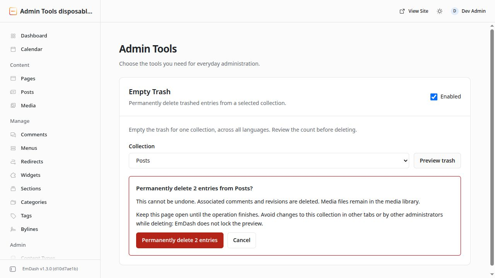

# EmDash Admin Tools

Independent, modular administrator tools for **EmDash 1.3.0**, starting with
**Empty Trash**. MIT licensed. No core patches, DOM injection, direct CMS database
writes, scheduled cleanup, or external services.

## Install

This is a **native plugin** with a React admin page. Native plugins are installed
as site dependencies and registered in Astro configuration; they cannot be
installed from the sandboxed EmDash registry. The package is not published to npm.

Build a package from this repository:

```sh
git clone https://github.com/vcode-sh/emdash-admin-tools.git
cd emdash-admin-tools
bun install --frozen-lockfile
bun run build
bun pm pack
```

In your EmDash site, install the resulting tarball:

```sh
bun add /path/to/emdash-admin-tools/emdash-admin-tools-0.1.0.tgz
```

Add the descriptor to the site's existing EmDash configuration:

```js
import emdash from "emdash/astro";
import { adminTools } from "emdash-admin-tools";

// Inside your existing defineConfig({ integrations: [...] }):
emdash({
  // Keep your site's existing database, storage and other configuration.
  plugins: [adminTools()], // Append to any existing plugins.
});
```

Rebuild/restart the site so EmDash bundles the admin entry. Activate the plugin
in **Plugins** if it is disabled, then open **Admin Tools** in the sidebar.
Installation changes site configuration only; it does not modify EmDash core.

## Empty Trash

1. Enable **Empty Trash** (enabled by default).
2. Select a content collection and preview its trash across all locales.
3. Confirm the displayed number of entries to permanently delete.
4. Keep the page open while the operation runs. Stop prevents further requests;
   an already started request may finish.

The preview follows every cursor page, including collections with more than
100 trashed entries. Confirmation fixes the requested candidate IDs for that run;
the plugin does not add new IDs while deleting. EmDash preserves entries that are
active at deletion time. A native `NOT_FOUND` response is counted as skipped.

Deletion uses EmDash's supported permanent-delete REST operation. EmDash owns
authorization, CSRF protection, deletion hooks, cache invalidation and cleanup of
comments, revisions, SEO and other entry relationships. Media files are retained.
This first version handles content collections, not the separate comments trash.

The batch is **not atomic**. On a failure, the page reports acknowledged progress
and stops; refresh and preview again before retrying. A lost response may mean a
request completed without an acknowledgement. Closing the page stops future
requests. There is no background job or automatic retry.

**Avoid concurrent changes to the selected collection during a run.** EmDash
1.3.0 does not accept a revision/deletion-time precondition for permanent deletion.
An entry restored and then trashed again under the same ID can still be deleted
by an earlier preview. EmDash also resolves identifiers as ID or slug: if a preview
ID disappears and another trashed entry has that exact slug, the host may delete
that other entry. The plugin checks returned IDs and stops on a mismatch, but
cannot undo that deletion. Client checks cannot make the host endpoint atomic.
Cleanup guarantees across database adapters remain those of EmDash itself.

## Modules and permissions

Each module has its own persisted switch. Disabling a module hides its action;
the deletion client also rechecks the setting before each request. Changes made
in another tab take effect before the next delete starts. EmDash owns overall
plugin activation; disabling the plugin removes its page and private routes.
These switches govern this plugin's controls, not EmDash's own deletion tools.

Only administrators can read/change module settings (`plugins:manage`) and
permanently delete content (`content:delete_permanent`). Collection discovery and
trash reads use the host's `schema:read` and `content:read_drafts` permissions.
Authorization remains enforced by the server, even if browser controls are bypassed.

The runtime declares no content, network or storage capabilities: its only server
work is plugin-scoped settings. Native plugins execute with host authority and
must be trusted; capability declarations do not sandbox native code.

## Development

- `src/modules/registry.ts`: module identity, label, setting key and default.
- `src/modules/<feature>/`: feature UI, behavior and host adapter.
- `src/settings.ts`: shared settings persistence and private routes.
- `src/admin/`: page shell, module components and scoped presentation.

To add a feature, add its module metadata and component, then register the
component in the admin page. Add server behavior only when that feature needs it.
Keep host details in the feature's adapter. There is no second plugin system or
dependency between features.

```sh
bun run check
bun run typecheck
bun run build
bun test
bun run dev:fixture
```

The fixture uses disposable database/media resources and stock EmDash. Tests do
not use shared development or production content. See [verification](docs/verification.md)
for the tested release boundary and checks.

## Verified host contracts

Baseline: EmDash **1.3.0**, upstream commit
[`d10d7ae1bd3a8635b9f67a14aec7226eaa633bda`](https://github.com/emdash-cms/emdash/tree/d10d7ae1bd3a8635b9f67a14aec7226eaa633bda).

- [Native plugin loading and activation](https://docs.emdashcms.com/plugins/creating-native-plugins/your-first-native-plugin/)
- [React admin pages and generated settings](https://docs.emdashcms.com/plugins/creating-native-plugins/react-admin/)
- [Supported REST API, trash pagination and permanent deletion](https://docs.emdashcms.com/reference/rest-api/)
- [Content deletion lifecycle](https://docs.emdashcms.com/reference/content-lifecycle/)
- [Native package distribution](https://docs.emdashcms.com/plugins/creating-native-plugins/distributing/)

The documented extension API does not offer a Trash toolbar action. This plugin
therefore provides its own Admin Tools page. It does not patch the native Trash UI.


